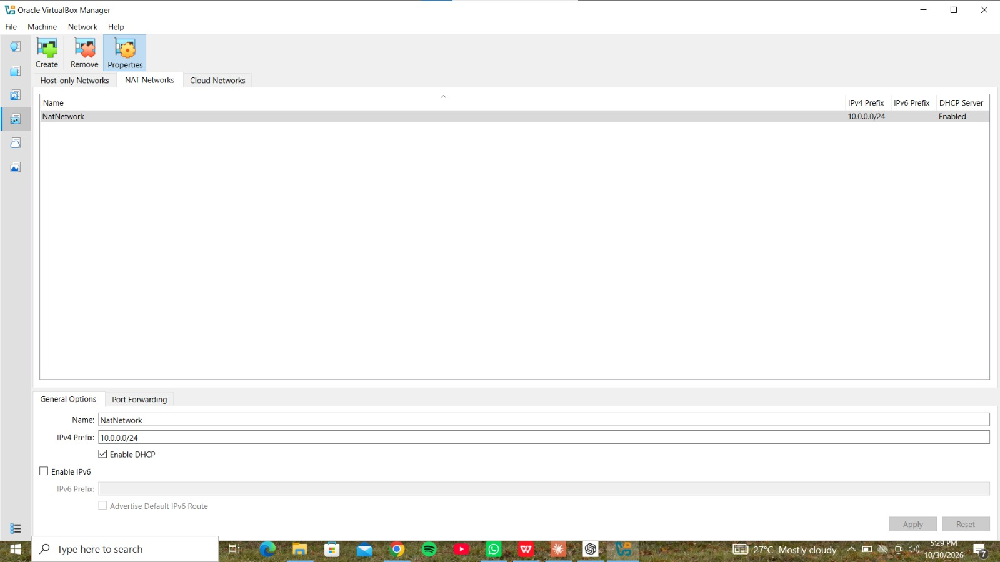
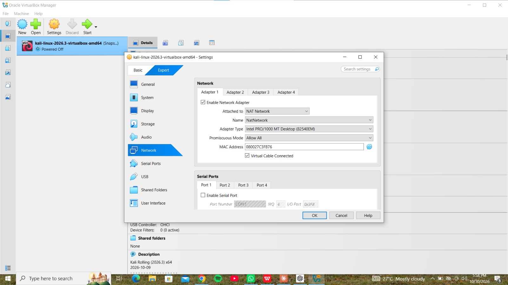
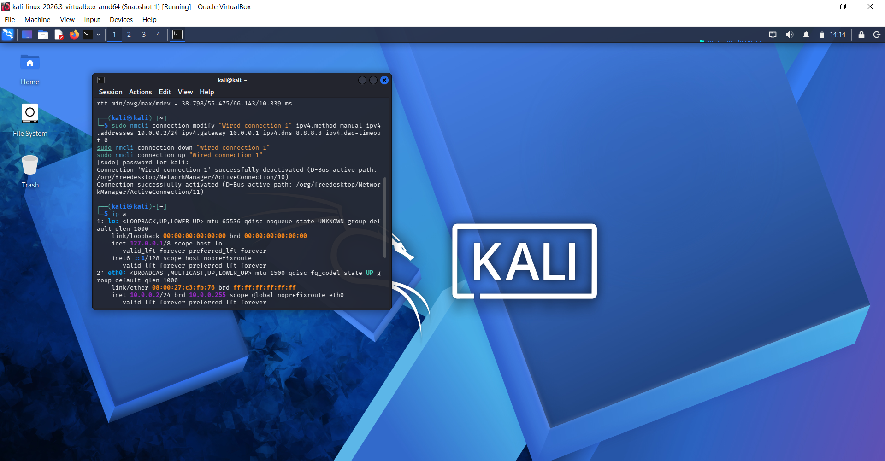
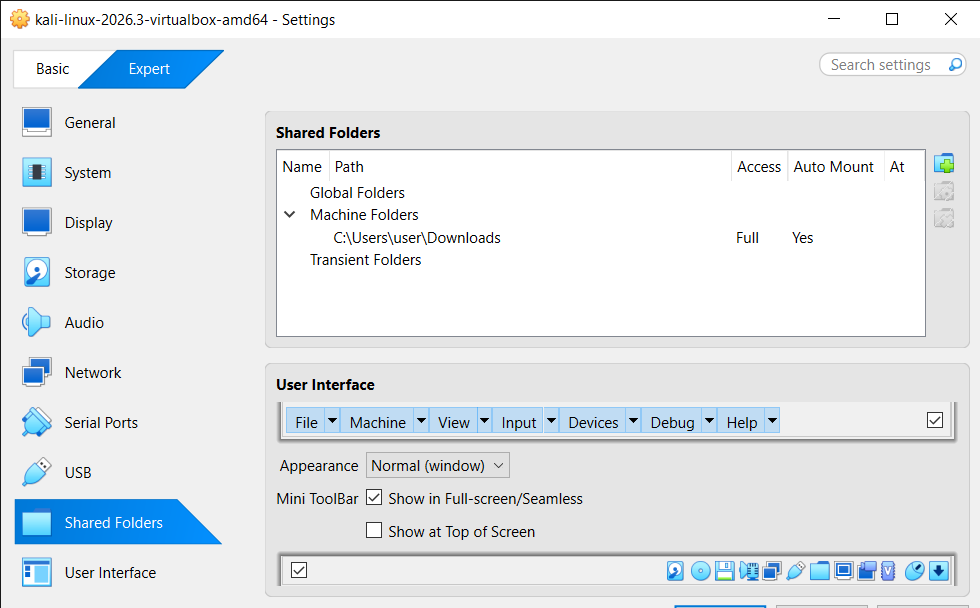
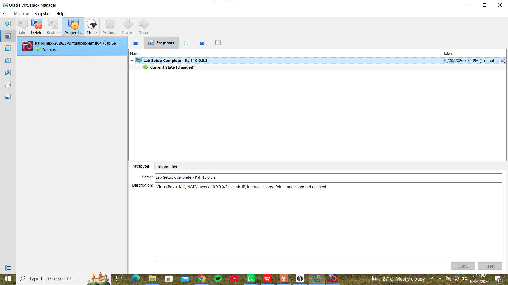
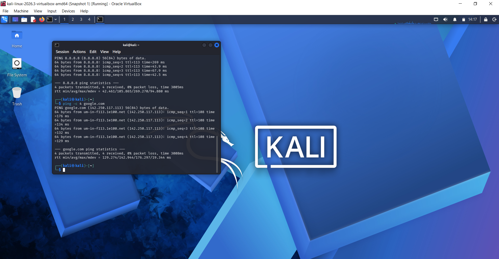

🔐 Cybersecurity Lab Environment Setup

Building an isolated virtual lab for penetration testing and ethical hacking practice.

 📌 Project Overview
This is my Week 1 project (WK1-PM1) for the Networkwalks Cybersecurity Internship. I built a virtual cybersecurity lab on my laptop using VirtualBox and Kali Linux. The lab runs on a private virtual network so I can safely practice security tools and add more machines later.

 🎯 Objectives
- Set up VirtualBox as the virtualization base
- Run Kali Linux as the attacker machine
- Create a NAT Network on the 10.0.0.0/24 subnet
- Give Kali the static IP 10.0.0.2/24 with full internet access
- Enable clipboard, drag and drop, and a shared folder
- Take a clean VM snapshot

 🖥️ Lab Configuration
| Item | Value |
|---|---|
| Hypervisor | Oracle VirtualBox |
| Attacker machine | Kali Linux 2026.3 |
| Network type | NAT Network (`NatNetwork`) |
| Subnet | 10.0.0.0/24 |
| Kali IP | 10.0.0.2/24 |
| Gateway / DNS | 10.0.0.1 / 8.8.8.8 |
| Clipboard & drag/drop | Bidirectional |
| Shared folder | Host Downloads folder |

 🛠️ Setup Procedure

### Step 1: Install 7-Zip and VirtualBox
I installed 7-Zip (to extract the Kali image) and the latest VirtualBox.

### Step 2: Create the NAT Network
In VirtualBox: File > Tools > Network > NAT Networks. I created `NatNetwork` with prefix 10.0.0.0/24 and DHCP enabled.



### Step 3: Import Kali Linux
I extracted the Kali VirtualBox image, added it to VirtualBox, and attached Adapter 1 to `NatNetwork` with Promiscuous Mode set to Allow All.



### Step 4: Set the static IP
In Kali, I set the IPv4 method to Manual with address 10.0.0.2/24, gateway 10.0.0.1 and DNS 8.8.8.8, using nmcli:

```
sudo nmcli connection modify "Wired connection 1" ipv4.method manual ipv4.addresses 10.0.0.2/24 ipv4.gateway 10.0.0.1 ipv4.dns 8.8.8.8 ipv4.dad-timeout 0
sudo nmcli connection down "Wired connection 1"
sudo nmcli connection up "Wired connection 1"
```



### Step 5: Enable clipboard, drag and drop, and shared folder
I set Shared Clipboard and Drag and Drop to Bidirectional, and shared my host Downloads folder with Auto-mount enabled.



### Step 6: Create a clean VM snapshot
I took a snapshot after everything was working so I can always restore a clean lab.



 ✅ Lab Verification
I confirmed Kali has the correct IP and full internet access with `ping 8.8.8.8` and `ping google.com`, both with 0% packet loss.



 🐞 Problems Encountered & Solutions

**Problem:** Kali showed "Wired connection 1" as disconnected, and after setting the static IP, pings failed with "Destination Host Unreachable".

**Solution:** I checked the NAT Network and adapter settings in VirtualBox, powered the VM off and on, and switched the connection to DHCP to confirm the network worked. Then I set the static IP again with nmcli (including `ipv4.dad-timeout 0`). After that, Kali had 10.0.0.2/24 and full internet access.

## 💡 What I Learned
- How to build an isolated NAT Network in VirtualBox
- How to set a static IP on Kali Linux with nmcli
- How to troubleshoot virtual network connectivity with `ip a` and `ping`
- Why snapshots matter for a lab environment
